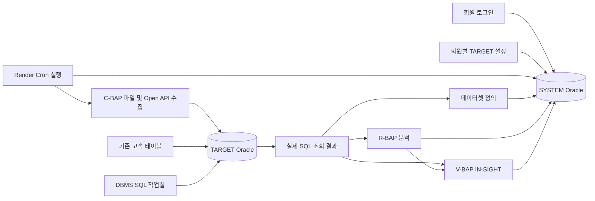

# IN-BAPS 회원 플랫폼 · 실제 DB 구조

작성 기준: 2026-10-29 회원/SYSTEM/TARGET 개편. 이전 자동 체험·SQLite 중심 설계는 현재 동작의 기준이 아닙니다. 제품 원칙은 C-BAP·R-BAP·V-BAP의 독립 사용과 명시적인 데이터 연결입니다.

## 데이터 경로

SYSTEM은 플랫폼 메타데이터를 관리하고 TARGET은 회원이 조회·편집하는 고객 데이터 DB입니다. 서로 다른 DB일 수 있습니다. 관리자가 SYSTEM 계정을 본인 TARGET으로 등록하는 경우에도 보호 테이블과 회원 소유 관리 테이블의 경계를 적용합니다.

C-BAP은 선택한 TARGET에 새 테이블과 실제 행을 저장합니다. 기존 고객 테이블을 조회하는 R-BAP/V-BAP은 C-BAP 실행을 요구하지 않습니다. R/V 파일 입력은 기본적으로 TARGET 없이 회원 소유 SYSTEM RECORD의 payload에 보관하며, TARGET 적재도 선택할 수 있습니다. R/V 직접 행 등록 API와 R 분석 결과를 V로 전달하는 독립 경로도 유지합니다. `/api/datasets/preview`는 전체 파일의 제한과 품질을 확인하고 처음 20행만 반환하며 DB에 쓰지 않습니다. 실제 저장은 명시적 `/api/datasets/import` 요청에서 수행하며 미리보기와 파일 hash를 비교할 수 있습니다. 어떤 경로도 자동 합성 행을 삽입하지 않습니다.

TARGET SQL 데이터셋은 `connection_id`, SQL, 바인드, 조회 상한을 SYSTEM 카탈로그에 저장합니다. 개별 데이터셋 조회·분석·시각화 사용 시 실제 TARGET SQL을 다시 실행합니다. 목록의 행 수·컬럼은 등록 시 메타데이터이며 상세 조회 결과와 달라질 수 있습니다. 지속적인 스트리밍이나 모든 행의 자동 동기화를 의미하지 않습니다.

R-BAP 통계 분석은 실제 조회한 결과 범위에 대해 Python 서버에서 수행합니다. SQL 작업실에서는 사용자가 Oracle 집계 SQL을 직접 실행할 수도 있습니다. V-BAP은 받아온 데이터와 저장한 차트 사양으로 ECharts를 렌더링하며 SQL/JS 코드를 브라우저가 임의 실행하도록 저장하지 않습니다.

## 소스와 참고한 구현

| 역할 | 현재 파일 | 참고 소스 |
|---|---|---|
| 회원가입·로그인 | `backend/auth_api.py`, `auth.py` | IN-EDITAONE `routers/auth.py`, `auth_context.py`, `M99001.py` |
| SYSTEM 접속·SQL ID | `backend/database.py`, `config.py`, `database/SQL/` | `database.py`, `database_helper.py` |
| TARGET 소유 연결·암호화 | `backend/target_database.py` | `target_database.py`, `security.py`, `M99001.py` |
| DBMS·DML·그리드 | `backend/target_api.py`, `frontend/js/M90003.js` | `M99002.py`와 해당 화면·SQL |
| DB 설정·리소스 제한 | `M90002.js`, `M90001.js`, 환경 설정 | `M99001`, `M91002`, `runtime_settings.py` |
| 메뉴·HTML/JS 분리 | `frontend/config/menu.config.js`, `pages/`, `js/` | 메뉴 코드·페이지 관리 구조 |

원본 `D:\work\in-editaone`은 읽기 전용 참고이며 새 서비스 실행 시 import하거나 호출하지 않습니다. 참고 소스의 일부 개발용 fallback·자동 DDL·내부 예외 노출을 그대로 복사하지 않고 현재 서비스의 명시적 설치·암호화·일반화한 오류 정책을 적용했습니다.

## SYSTEM 오브젝트 계약

| 오브젝트 | 용도 |
|---|---|
| `INIT$_TB_BAPS_MEMBER` | 회원과 해시 비밀번호, analyst/admin 권한 |
| `INIT$_TB_BAPS_SESSION` | 토큰 해시·CSRF·최대 만료·유휴 만료·마지막 활동 |
| `INIT$_TB_BAPS_CONNECTION` | 소유자별 연결·암호화한 TARGET 비밀번호·쓰기 허용·관리 테이블 목록 |
| `INIT$_TB_BAPS_RECORD` | 데이터셋/분석/시각화/대시보드 payload |
| `INIT$_TB_BAPS_HISTORY` | migration 체크섬·적용 시각·RUNNING/APPLIED |
| `INIT$_TB_BAPS_API_SOURCE` | 회원별 API 설정·암호화 인증값·TARGET 매핑·실행 잠금 |
| `INIT$_TB_BAPS_API_JOB` | 지속형 일정·다음 실행 시각·활성 상태 |
| `INIT$_TB_BAPS_API_RUN` | 수동/배치 수집의 상태·저장 행 수·오류 이력 |
| `INIT$_VW_BAPS_CATALOG` | 카탈로그 조회 뷰 |
| `INIT$_SP_BAPS_SESSION_PURGE` | 명시적으로 호출하는 만료 세션 정리 |
| `INIT$_IX_BAPS_*` 및 `INIT$_PK/UK/FK/CK_BAPS_*` | 인덱스·제약 |

접두어는 테이블 TB, 프로시저 SP, 뷰 VW, 인덱스 IX, 기본 키 PK, 유일 UK, 외래 키 FK, 검사 CK로 구분합니다. 모든 자체 SYSTEM 이름에는 BAPS를 포함하여 기존 제품과 충돌하지 않게 합니다. 고객 기존 테이블은 조회 대상이며 강제로 이름을 바꾸지 않습니다.

이전 INBAPS_* V001은 원본 SHA를 유지한 참조 보관본으로 이동했습니다. 신규 INIT$_ 구조 설치 전에 실제 연결 스키마의 IN-BAPS 전용 오브젝트가 없음을 확인했으며, 기존 제품의 테이블·회원·연결 암호를 복제하거나 변경하지 않았습니다.

## 회원·세션·접속 정보

회원가입은 일반 analyst만 생성하고 이미 등록된 아이디·짧은 비밀번호·임의 역할 입력을 거부합니다. 아이디는 3~100자 영문·숫자 및 허용 기호이며 소문자로 정규화합니다. 비밀번호는 12~256자이고 PBKDF2-HMAC-SHA256으로 저장합니다. 환경 관리자 생성은 기존 일반 회원을 승격하지 않습니다.

무작위 세션 토큰을 HttpOnly·SameSite=Lax 쿠키로 발급하고 SYSTEM DB에는 SHA-256 해시만 저장합니다. 운영 환경은 Secure 쿠키를 요구합니다. 업무 요청은 실제 DB 세션의 회원 ID·역할로 승인하며 헤더나 localStorage의 권한 주장을 사용하지 않습니다.

최대 수명은 기본 8시간, 유휴 만료는 기본 30분입니다. 활동 연장은 절대 만료를 넘을 수 없습니다. GET 세션 조회는 유휴 시간을 연장하지 않습니다. 로그인 시 토큰을 교체하고 로그아웃 시 현재 DB 세션을 삭제합니다. 변경 요청에는 세션 CSRF와 같은 출처 검증을 적용합니다. 인증 요청은 프로세스별 IP 5분 12회로 제한하며 분산 공통 제한을 대체하지 않습니다.

TARGET 비밀번호는 안정적인 `BAPS_SECRET_KEY`로 Fernet 암호화합니다. 키가 없으면 평문이나 base64로 저장하지 않고 실패합니다. 목록·시험 응답에는 저장된 암호를 돌려주지 않습니다. 회원 소유 연결 ID를 확인한 뒤에만 접속합니다. SYS/SYSTEM 직접 TARGET 등록은 지원하지 않습니다.

## DBMS 작업과 경계

DBMS는 선택 연결의 오브젝트·컬럼·기본 키·DDL을 보여 줍니다. SELECT/WITH·집합 쿼리를 구문 트리로 검사하고 단일 문장만 실행합니다. CTE 참조를 범위별로 구분하여 보호 테이블 이름으로 우회할 수 없도록 검사합니다. DB 링크·다른 스키마·PLSQL·임의 DDL·잠금 SELECT·패키지/허용되지 않은 사용자 함수 실행을 제한합니다. SELECT 연결은 읽기 전용 트랜잭션입니다.

일반 TARGET 연결은 DB 자체 권한을 따르므로 운영자가 허용한 일반 업무 계정을 사용합니다. SYSTEM 공유 연결 또는 SYSTEM 사용자명 재사용 연결은 본인이 등록·적재한 관리 테이블로 접근을 제한합니다. 회원·세션·연결·이력·레코드 등 SYSTEM 보호 테이블은 모든 연결의 작업실 접근에서 제외합니다. 이 제한을 DB 계정 자체의 최소 권한 정책과 혼동하지 않습니다.

관리자는 공유 스키마 전체의 **목록 메타데이터**를 확인할 수 있습니다. `metadata_only` 항목의 이름·유형·상태 노출과 데이터·DDL 접근은 분리하며 SQL 검증을 완화하지 않습니다. 목록 정책은 연결 `CONFIG_JSON.object_filter`에 저장하고 GET/PUT `/api/connections/{id}/object-filter`에서 소유권·CSRF·역할을 확인합니다. `/api/dbms/objects?details=true`는 폴더용 목록과 적용 범위·제외 건수·최대 표시 제한을 제공합니다. 기존 배열 응답은 `details`를 생략하면 유지합니다. 행 잠금으로 비밀번호·소유 테이블·표시 설정의 동시 변경을 병합합니다. DDL 조회는 실제 오브젝트 종류 및 인덱스/트리거의 연관 테이블을 재조회하여 별도로 권한을 확인합니다.

INSERT/UPDATE/DELETE는 연결에서 쓰기를 허용한 뒤 사용할 수 있습니다. 기본 미리보기는 실제 DML 실행 후 롤백하고 저장 요청만 커밋합니다. DML 실행 한도는 1,000행, 그리드 저장은 1행입니다. DB 트리거·자율 트랜잭션 등 DB 자체 부작용은 일반 롤백 경계를 벗어날 수 있으므로 쓰기 계정의 업무 규칙을 따릅니다.

그리드 수정·삭제는 기본 키와 조회 당시 모든 원본 컬럼을 조건에 포함하여 동시 변경을 검사합니다. 날짜·숫자는 실제 컬럼 타입에 맞게 바인딩합니다. LOB/RAW/INTERVAL/XML 계열은 그리드 편집 대신 SQL 작업창을 사용하도록 제한합니다. 테이블 생성·NULL 허용 컬럼 추가는 별도의 구조 변경 API가 담당합니다.

M90003 사용자 오브젝트에는 IN-BAPS 시스템의 `INIT$_` 명명 규칙을 강제하지 않습니다. 테이블·컬럼 이름은 대소문자·한글·공백을 보존하여 하나의 SQL 식별자로 안전하게 인용합니다. 기본 키 제약은 시스템 접두어를 붙이지 않고 DB가 이름을 정하게 합니다. 길이 검증과 SYSTEM 보호, 쓰기 권한·회원 소유권·DDL 기록은 기존대로 적용합니다.

쿼리는 최대 20,000행·100컬럼·10MiB 결과, 페이지 offset 상한 1,000,000, DB 호출 제한 15초를 적용합니다. 오브젝트 목록은 최대 1,000개입니다. 문자열 결과 셀은 10,000자에서 잘라 표시하므로 잘린 원문을 편집 원본으로 사용하지 않습니다.

## 샘플·수집·DDL 보관

로그인·서비스 시작에서는 샘플을 만들지 않습니다. DB 설정의 예제 생성은 선택한 TARGET에 12개월×3채널의 합성 예제 36행을 실제 적재하고 `synthetic=true` 및 설명을 저장합니다. 사용자 업무 실적과 구분합니다. 이후 쿼리·분석·차트는 그 실제 테이블을 읽습니다.

C-BAP은 `INIT$_TB_BAPS_C_<식별자>` 테이블에 행 식별자와 타입을 판별한 컬럼을 생성합니다. 숫자는 NUMBER, 그 외 값은 VARCHAR2로 저장하며 원래 컬럼 이름은 조회 별칭으로 복원합니다. 값은 바인드합니다.

오브젝트 생성·컬럼 추가 SQL 템플릿은 `database/DDL/`, `database/ALT/`에 두고 실행 SQL은 `.runtime/ddl/<회원식별해시>/<실행식별자>.sql`에 기록합니다. DDL 후 SYSTEM 등록이 실패하면 생성된 테이블을 삭제하지 않고 명확한 오류와 DDL 기록으로 복구하도록 합니다. 기록은 실행 시도 SQL이며 실제 성공 여부와 함께 확인해야 합니다. 데이터셋 삭제가 물리 TARGET 테이블을 자동 삭제하지 않습니다.

`baps-backup`은 생성 DDL SQL 기록을 소스와 함께 보관하고 다른 런타임 상태·비밀값은 제외합니다. SYSTEM 재현은 반복 초기 설치와 후속 버전, TARGET 재현은 구조 기록과 실제 DBMS DDL을 검토해 수행합니다. 데이터와 암호화 키의 복구는 별도입니다.

## API

응답은 `{status:"success",data:...}` 형식을 사용합니다.

| 용도 | 경로 |
|---|---|
| 가입·로그인·세션·명시적 연장·로그아웃 | `/api/auth/signup`, `login`, `session`, `activity`, `logout` |
| TARGET 연결 | `/api/connections`, `/{id}`, `/{id}/test`, 관리자용 `/system` |
| 접속 방식·서버 TNS 목록 / 저장 전 시험 | GET `/api/connections/options`, POST `/api/connections/test` |
| DBMS 조회·DML·그리드 | `/api/dbms/objects`, `columns`, `ddl`, `query`, `dml`, `grid` |
| TARGET 테이블·컬럼 생성 | POST `/api/dbms/tables`, POST `/api/dbms/columns` |
| SQL 데이터셋·수집·샘플 | `/api/dbms/datasets`, `import`, `sample` |
| 카탈로그·분석·시각화 | `/api/datasets`, `/api/analysis`, `/api/visualizations` |
| 관리자 스키마 확인·SQL 다운로드·반복 검증 | `/api/system/schema`, `/sql`, `/initialize` |

관리 화면의 반복 초기 검증은 이미 로그인할 수 있는 관리자를 위한 기능입니다. 최초 SYSTEM 테이블이 없는 DB에서는 SQL 파일/CLI로 먼저 설치합니다. 서비스 시작이 DDL을 자동 실행하지 않습니다.

TARGET 상세 GET `/{id}`는 소유권 검사 후 일반 연결의 저장 조건 또는 서버 공유 연결의 실제 사용자·DSN을 반환합니다. 비밀번호·Wallet 경로와 파일 내용은 포함하지 않습니다. `connection_type`은 기존 CONFIG_JSON에 저장하며, 이전 레코드는 DSN에서 형식을 판별하므로 스키마 변경이 필요 없습니다. 등록 전 시험은 새 설정을 메모리에서만 준비하고 기존 시험과 동일한 `TARGET_IDENTITY` SELECT를 실행합니다. 편집 중 비밀번호를 생략하면 소유 연결의 암호를 재사용합니다. 서버 프로필은 현재 한 개이며 회원별 Wallet 업로드/선택은 구현 범위에 포함되지 않습니다.

## 검증 상태와 남은 범위

회원/세션 8개와 기존 백엔드 10개 API 회귀는 격리 DB에서 검증했습니다. TARGET SQL·소유권·그리드·DDL은 별도 테스트로 검증하며 가짜 드라이버 검증을 실 DB 실행 성공으로 표현하지 않습니다.

2026-10-29 초기 데이터 기록의 ORA-01950은 사용자가 승인한 ADMIN 연결로 SYSTEM 소유 계정의 DATA quota를 100MiB로 설정하여 해결했습니다. BASE03 연결에서 설치 SQL을 두 번 실행했고, 실제 Oracle에서 회원가입·로그인/로그아웃·암호화 연결 저장·TARGET 적재·SQL DML·그리드 충돌·SQL 재조회·R-BAP 집계·V-BAP 저장·CREATE/ALTER·TIMESTAMP 입력·명시적 샘플 적재·세션 만료를 검증했습니다. 10단계 결과는 [현재 검증 기록](../VALIDATION_MEMBERSHIP.md)과 로컬 `.runtime/qa/oracle-functional.json`에 남겼습니다. 이 검증은 QA 회원과 검증용 데이터를 사용하며 실제 고객 업무 데이터의 정확성을 보증하는 검사는 아닙니다. Git push·Render 공개 배포는 수행하지 않았습니다.

실제 Oracle JSON 객체 반환 형식을 포함한 Python 회귀는 총 44개를 통과했습니다. 데이터 적재 후 반복 설치에서도 SYSTEM 행 보존을 확인했습니다. `http://127.0.0.1:9000`의 실제 API를 사용하는 브라우저로 관리자 로그인·빈 인법스·관리자 소유 기본 TARGET·바인드 SQL 조회·SYSTEM 화면·로그아웃을 확인했고 브라우저 오류는 없었습니다.

현재 범위에는 외부 자동 수집·작업 스케줄러·외부 R/BI 연계·MFA·비밀번호 재설정 UI·조직별 공유 권한·대규모 분산 분석이 포함되지 않습니다. 지원하지 않는 연결을 실제로 동작하는 것처럼 표시하지 않습니다.

